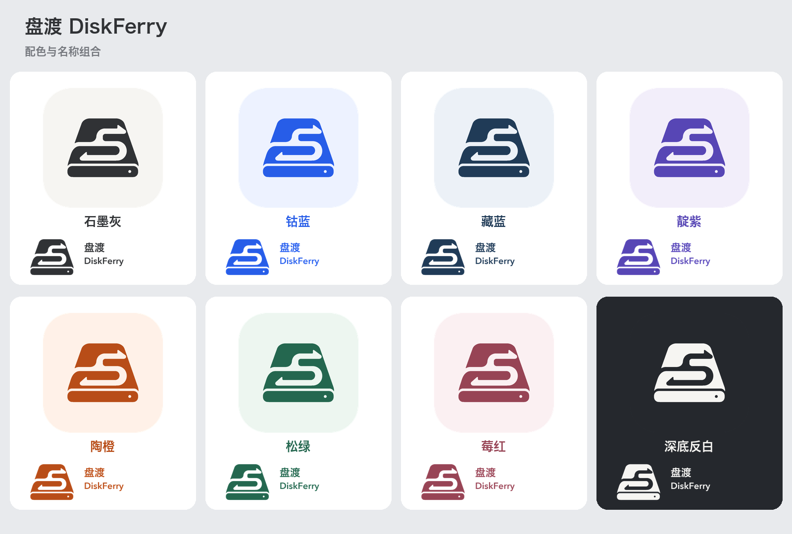

# 盘渡 DiskFerry 品牌素材

盘渡采用 **S 形双向路径图标**，默认配色为石墨灰。此目录保存应用、网站、文档可直接使用的素材，以及可复现的导出脚本。



## 包含内容

- 8 种配色 × 6 种版式 × PNG / JPG，共 **96 张主素材**。
- 8 种配色的 macOS ICNS 图标，共 8 个。
- 16、32、64、128、256、512、1024 像素的应用图标 PNG，共 56 张。
- PNG / JPG 总览图、已选母版、透明形状蒙版、配色定义和文件清单。

## 文件名与使用方式

主素材放在 `png/<配色>/` 与 `jpg/<配色>/` 下，文件名统一为 `diskferry-<版式>.png` 或 `.jpg`。

| 版式 | 名称内容 | 尺寸 | 适合用途 |
| --- | --- | --- | --- |
| `icon` | 不带名称，包含圆角底板 | 1024 × 1024 | 应用图标、头像 |
| `symbol` | 不带名称，仅磁盘标志 | 1024 × 1024 | 网页、文档或自定义背景上的标志 |
| `name-en-horizontal` | DiskFerry，横向 | 2400 × 900 | 英文页眉、网站或文档标题 |
| `name-zh-en-horizontal` | 盘渡 + DiskFerry，横向 | 2400 × 900 | 中文网站或文档标题 |
| `name-en-stacked` | DiskFerry，竖向 | 1600 × 1600 | 方形展示、介绍页 |
| `name-zh-en-stacked` | 盘渡 DiskFerry，竖向 | 1600 × 1600 | 中文方形展示、介绍页 |

PNG 为 RGBA：图标底板外部透明；纯标志和名称组合的底部透明，内部留白也透明，便于放到自定义背景上。JPG 为 RGB：普通配色铺白底，深底反白版铺石墨黑底，不会出现错误的黑色透明区。

纯标志与名称组合的 `inverse` PNG 使用浅色图形和文字，适合深色背景。应用图标 `inverse/icon` 自带深色圆角底板。

## 配色与快速取用

| 配色 | 标志颜色 | 图标 PNG | 图标 JPG | 中英文横版 PNG | 中英文竖版 PNG |
| --- | --- | --- | --- | --- | --- |
| 石墨灰 `graphite` | `#303235` | [PNG](png/graphite/diskferry-icon.png) | [JPG](jpg/graphite/diskferry-icon.jpg) | [横版](png/graphite/diskferry-name-zh-en-horizontal.png) | [竖版](png/graphite/diskferry-name-zh-en-stacked.png) |
| 钴蓝 `cobalt` | `#275DE8` | [PNG](png/cobalt/diskferry-icon.png) | [JPG](jpg/cobalt/diskferry-icon.jpg) | [横版](png/cobalt/diskferry-name-zh-en-horizontal.png) | [竖版](png/cobalt/diskferry-name-zh-en-stacked.png) |
| 藏蓝 `navy` | `#203B57` | [PNG](png/navy/diskferry-icon.png) | [JPG](jpg/navy/diskferry-icon.jpg) | [横版](png/navy/diskferry-name-zh-en-horizontal.png) | [竖版](png/navy/diskferry-name-zh-en-stacked.png) |
| 靛紫 `indigo` | `#5746B5` | [PNG](png/indigo/diskferry-icon.png) | [JPG](jpg/indigo/diskferry-icon.jpg) | [横版](png/indigo/diskferry-name-zh-en-horizontal.png) | [竖版](png/indigo/diskferry-name-zh-en-stacked.png) |
| 陶橙 `orange` | `#B84D18` | [PNG](png/orange/diskferry-icon.png) | [JPG](jpg/orange/diskferry-icon.jpg) | [横版](png/orange/diskferry-name-zh-en-horizontal.png) | [竖版](png/orange/diskferry-name-zh-en-stacked.png) |
| 松绿 `forest` | `#24674F` | [PNG](png/forest/diskferry-icon.png) | [JPG](jpg/forest/diskferry-icon.jpg) | [横版](png/forest/diskferry-name-zh-en-horizontal.png) | [竖版](png/forest/diskferry-name-zh-en-stacked.png) |
| 莓红 `burgundy` | `#974455` | [PNG](png/burgundy/diskferry-icon.png) | [JPG](jpg/burgundy/diskferry-icon.jpg) | [横版](png/burgundy/diskferry-name-zh-en-horizontal.png) | [竖版](png/burgundy/diskferry-name-zh-en-stacked.png) |
| 深底反白 `inverse` | `#F6F5F2` | [PNG](png/inverse/diskferry-icon.png) | [JPG](jpg/inverse/diskferry-icon.jpg) | [横版](png/inverse/diskferry-name-zh-en-horizontal.png) | [竖版](png/inverse/diskferry-name-zh-en-stacked.png) |

横版、竖版和纯标志的 JPG 使用相同配色目录与文件名，扩展名为 `.jpg`。

## macOS 应用资源

- `app-icons/icns/diskferry-<配色>.icns`：直接可用的 macOS 图标文件。
- `app-icons/png/<配色>/diskferry-<尺寸>.png`：不同尺寸的应用图标。
- 原始默认灰白版本：[石墨灰 ICNS](app-icons/icns/diskferry-graphite.icns)。

## 母版与复现

- [已选图标母版](source/approved-s-icon.png)：保留选定的图形，所有变体使用同一形状。
- [透明形状蒙版](source/approved-symbol-alpha.png)：从已选扁平图标提取，所有配色使用同一形状。
- [配色配置](palettes.json)：标志、图标底板与 JPG 背景的色值。
- [文件清单](manifest.json)：各文件的版式、配色、格式、尺寸、透明说明及 SHA-256。
- [导出脚本](export_assets.py)：在 macOS、已安装 Pillow 的 Python 3 中运行即可重新导出。

```bash
python3 Resources/Brand/export_assets.py
```

导出需要 Python 3、Pillow（`python3 -m pip install Pillow`）及 macOS 自带的 `iconutil`。字样为 `盘渡` 与 `DiskFerry`，使用系统字体 Hiragino Sans GB W6、Avenir Next Demi Bold 渲染；字体文件未捆绑。已导出的素材可以直接使用，构建应用不需要 Pillow 或重新导出图标。应用构建脚本使用 [石墨灰 ICNS](app-icons/icns/diskferry-graphite.icns)。
